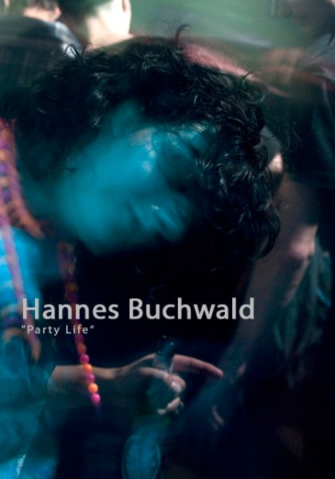
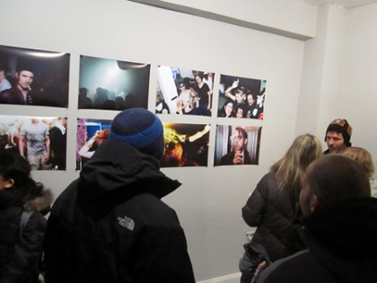
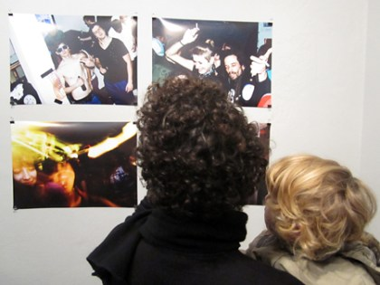
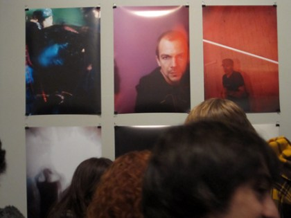

# Party Life

## Beschreibung

Die Fotoserie dokumentiert das Heilbronner Nachtleben. Buchwald begleitete Veranstaltungen im Mobilat Club und Data 77112 und hielt das Zusammenspiel von Licht, Bewegung und Körpersprache fest.

„Party Life“ war eine Fotoausstellung von Hannes Buchwald im Basementizid in Heilbronn. Der Ausstellungshinweis von Carhartt WIP nennt den Zeitraum vom 20. Dezember 2009 bis zum 12. Januar 2010.

Basementizid ist ein Galerie- und Kunstprojekt von Sergej Vutuc, das zeitgenössische Arbeiten aus Bild, Wort und Klang sowie den Austausch regionaler und internationaler Künstler fördert. Die Ausstellung ist als Galerieausstellung dokumentiert; eine Museumsbeteiligung ist mit diesen Quellen nicht belegt.

## Zeitraum

20. Dezember 2009 bis 12. Januar 2010. Die Vernissage wurde für den 20. Dezember 2009 um 16 Uhr angekündigt.

## Meine Rolle

Fotograf und ausstellender Künstler.

## Ergebnisse

- Präsentation fotografischer Arbeiten im Basementizid, Heilbronn.
- Ausstellungshinweis im Carhartt WIP Journal vom 18. Dezember 2009.

## Bilder und Links

- [Ausstellungshinweis: Hannes Buchwald „PARTY LIFE“](https://www.carhartt-wip.com/en/journal/skate/2009/12/hannes-buchwald-party-life-20-12-2009-12-01-2010).
- [Basementizid-Blog](https://basementizid.wordpress.com/).

Bilder lokal aus dem [Party-Life-Beitrag des Basementizid-Blogs](https://basementizid.wordpress.com/2010/01/10/hannes-buchwald-party-life-20-dezember-09-bis-12-januar-10/) gespeichert. Bildnachweise wie in der Quelle; die Dateinamen enthalten keinen verlässlichen Aufnahmezeitpunkt.

## Quellen und Abgrenzung

- [Party-Life-Ausstellungsbeitrag](https://basementizid.wordpress.com/2010/01/10/hannes-buchwald-party-life-20-dezember-09-bis-12-januar-10/), 10. Januar 2010: Beschreibung, Bilder, Ausstellungsdaten und wiedergegebener Pressebericht „Im Rausch der Nacht“ von Michaela Adick.

- Carhartt WIP Journal, 18. Dezember 2009: Titel, Künstler, Ausstellungszeitraum, Vernissage und Ort.
- Basementizid-Blog: Hintergrund zum Galerieprojekt und Sergej Vutuc.
- [Eventfotografien von Hannes Buchwald im Basementizid-Blog](https://basementizid.wordpress.com/2009/04/15/all-photos-hannes-buchwald-basementizid-event/), 15. April 2009: weiterer Nachweis seiner fotografischen Arbeit im Umfeld der Galerie, jedoch kein Beleg für die spätere Ausstellung „Party Life“.
