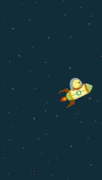

# SfG Game Course

## Beschreibung

Der „SfG Game Course“ ist ein praxisorientierter Spieleentwicklungskurs an der Schule für Gestaltung in Heilbronn. Er richtet sich an Schülerinnen und Schüler der Klassen 11 bis 13 ohne Programmierkenntnisse. In kleinen, praktisch nachvollziehbaren Schritten lernen sie Grundlagen der Programmierung und entwickeln ein eigenes Spiel.

Zum Einsatz kommen HTML, CSS und JavaScript. Die Kurswebseite erklärt, dass die Spiele im Browser gespielt und für die Nutzung als Smartphone-App umgewandelt werden können. Für den ersten Kurs präsentiert sie selbst programmierte 2D-Jump-and-Run-Spiele.

## Zeitraum

2016/2017: Auf der Webseite als erster Kurs ausgewiesen. Weitere Kurszeiträume sind dort nicht angegeben.

## Meine Rolle

Hannes Buchwald wird auf der Kurswebseite als Dozent an der SfG Heilbronn und Verantwortlicher für den Spieleentwicklungskurs genannt.

## Kursinhalte

- Einstieg in die Programmierung ohne erforderliche Vorkenntnisse.
- Praktisches Lernen in kleinen Etappen.
- Spieleentwicklung mit HTML, CSS und JavaScript.
- Entwicklung eines eigenen 2D-Jump-and-Run-Spiels.
- Browsernutzung und mögliche Umwandlung in eine Smartphone-App.

## Ergebnisse

Die Kurswebseite dokumentiert den ersten Kurs 2016/2017 und verlinkt die individuell entwickelten Spiele der Teilnehmenden. Auch ein Spiel von Hannes Buchwald ist dort verzeichnet.

## Bilder und Links

- [Kurswebseite und Übersicht der Spiele](http://sfg-games.hannesbuchwald.com/).
- [Spiel von Hannes Buchwald](http://sfg-games.hannesbuchwald.com/kurse/2016_01/hannes/index.html).

Beide Abbildungen lokal von der [Kurswebseite](http://sfg-games.hannesbuchwald.com/) gespeichert. Originale: http://sfg-games.hannesbuchwald.com/images/thumbnail_hannes.jpg und http://sfg-games.hannesbuchwald.com/images/icon_html5_css_js.png

## Quellen

[SfG Game Course – offizielle Kurswebseite](http://sfg-games.hannesbuchwald.com/), insbesondere die Abschnitte Kursinhalt, Dozent und 1. Kurs 2016/2017. Gelesen am 12. Oktober 2026.

Die Beschreibung fasst die Kurswebseite in eigenen Worten zusammen. Die Funktionsfähigkeit der einzelnen Spiele und der Smartphone-Umwandlung wurde nicht geprüft.
