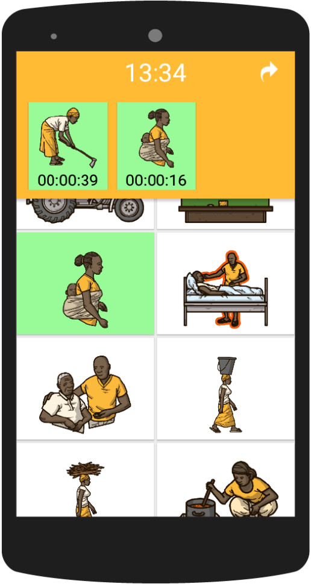

# Time Tracker

## Beschreibung

TimeTracker ist eine Smartphone-Anwendung zur Erfassung von Forschungsdaten. Sie wurde in Zusammenarbeit der Universität Hohenheim und der Hochschule der Medien Stuttgart entwickelt und zur Untersuchung der Zeitnutzung im ländlichen Sambia eingesetzt.

Die Teilnehmenden erfassen ihre Aktivitäten selbst und zeitnah. Dadurch sollen Erinnerungsfehler verringert werden, die bei rückblickenden Befragungen entstehen können. Eine bildgestützte Eingabe erleichtert die Nutzung für Menschen mit geringen Lese- und Schreibkenntnissen. Das Projekt verbindet App-Entwicklung und Gestaltung mit Fragen der Entwicklungsforschung.

## Zeitraum

Der genaue Projektzeitraum wird noch ergänzt. Die Projektwebseite führt Veröffentlichungen aus den Jahren 2017 und 2018 auf; daraus wird kein Beginn oder Ende der persönlichen Mitarbeit abgeleitet.

## Meine Rolle

Hannes Buchwald wird auf der Projektwebseite mit der Rolle „Coding & Design“ genannt.

## Zusammenarbeit

Das auf der Webseite vorgestellte Team verbindet Forschung, Programmierung, Design, Illustration und lokale Forschungsassistenz. Thomas Daum wird als Projektleiter, Natalis Lorenz für die Illustrationen sowie Regina Birner und Ansgar Gerlicher für die wissenschaftliche Betreuung genannt.

## Ergebnisse

- Entwicklung einer bildgestützten Smartphone-Anwendung zur Datenerhebung.
- Einsatz zur Erfassung von Zeitnutzungsdaten im ländlichen Sambia, laut Projektwebseite.
- Wissenschaftliche Veröffentlichungen zur Methode und ihrer Anwendung.

## Veröffentlichungen

Alle folgenden Links und Datumsangaben wurden aus dem Bereich „Publications“ der Projektwebseite übernommen. Die einzelnen Zielseiten wurden nicht auf Aktualität oder Erreichbarkeit geprüft. Einige Links führen zu Übersichtsseiten; die Zuordnung folgt der damaligen Projektwebseite. Eine persönliche Autorenschaft oder Vortragstätigkeit Hannes Buchwalds wird dadurch nicht behauptet.

### Papers

- [Times Have Changed: Using a Pictorial Smartphone App to Collect Time–Use Data in Rural Zambia](https://doi.org/10.1177/1525822X18797303) — SAGE Publications, Oktober 2018.
- [Smartphone Apps as a new Method to Collect Data on Smallholder Farming Systems in the Digital Age: A Case Study from Zambia](https://authors.elsevier.com/c/1XYVdcFCSBlT6) — Elsevier / ScienceDirect, August 2018.
- [The Potential of Apps to Study Smallholder Farming Systems and More](https://www.rural21.com/uploads/media/rural2017_04-S45-47.pdf) — Rural21, April 2017 laut Projektwebseite.

### Press

- [Einflüsse auf die Arbeitsteilung](https://www.focus.de/regional/stuttgart/universitaet-hohenheim-einfluesse-auf-die-arbeitsteilung_id_9034741.html) — Focus Online, 4. Juni 2018.
- [Sambia Kleinbauern stärken](https://www.agrarheute.com/traction/magazin/aktuelles-heft-3-2018) — Traction 3/2018, 1. Mai 2018.
- [Aufschlussreiches Klick-Tagebuch](http://www.stuttgarter-zeitung.de/inhalt.hochschule-der-medien-und-uni-hohenheim-forschen-in-afrika-aufschlussreiches-klick-tagebuch.cbecb83e-7405-4c4c-9af2-2b4f32dd54fb.html) — Stuttgarter Zeitung, 7. Februar 2017.
- [„Time-Tracker-App“ – Kleinbauern in Afrika nutzen Arbeitszeiterfassung per Smartphone](https://www.landtechnik-online.eu/ojs-2.4.5/index.php/landtechnik/announcement) — Landtechnik, 12. Januar 2017.
- [App zeigt Arbeitsbelastung afrikanischer Kleinbauern auf](https://www.glaubeaktuell.net/nachrichten/wirtschaft/) — Glaubeaktuell, 11. Januar 2017.
- [Weitere Veröffentlichungen auf der Projektwebseite](http://timetracker.cc/creative-corporation/press/).

### Awards

- [Award: Landmark 2018](https://land-der-ideen.de/projekt/forschungs-app-time-tracker-3795) — Germany Land of Ideas / Deutschland – Land der Ideen, 4. Juni 2018 laut Projektwebseite.

### Presentations

- [GEWISOLA 2018 Conference](http://www.gewisola2018.uni-kiel.de/de) — 58. GEWISOLA-Jahrestagung, Kiel, 12.–14. September 2018.
- [30th International Conference of Agricultural Economists](http://www.icae2018.com/) — IAAE, Vancouver, 28. Juli–2. August 2018.
- [ICBAR 2018](http://www.worldbank.org/en/events/2017/10/11/disruptive-innovations-value-chains-and-rural-development) — International Consortium on Applied Bioeconomy Research, Weltbank, Washington, D.C., 12.–15. Juni 2018 laut Projektwebseite. Die verlinkte URL enthält 2017; diese Abweichung ist noch ungeprüft.
- [GIL 2018 Conference](https://www.gil-net.de/Tagung/) — GIL-Jahrestagung, Kiel, 26.–27. Februar 2018.

## Bilder und Links

- [TimeTracker – Quellcode auf GitHub](https://github.com/HannesBuchwald/TimeTracker).

- [TimeTracker – Projektwebseite](http://timetracker.cc/).

App-Abbildung lokal gespeichert von der [TimeTracker-Projektwebseite](http://timetracker.cc/). Original: http://timetracker.cc/wp-content/uploads/2017/05/timetracker-front-uai-516x969.png

## Quellen

[TimeTracker – Projektwebseite](http://timetracker.cc/), insbesondere About the Project, Publications und Team Members. Gelesen am 12. Oktober 2026.
